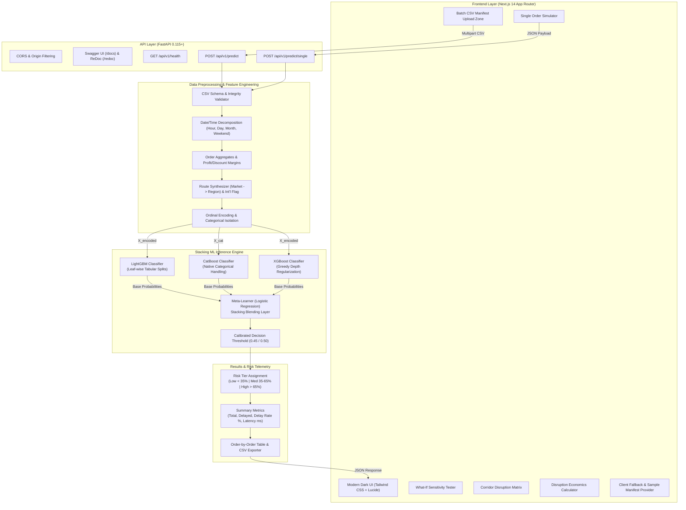

# DelaySense™ — AI Supply Chain Delay Prediction & Risk Engine

<div align="center">

[](https://nextjs.org/)
[](https://fastapi.tiangolo.com/)
[](https://www.python.org/)
[](https://www.typescriptlang.org/)
[](https://tailwindcss.com/)
[](https://www.docker.com/)
[](https://render.com/)
[](./LICENSE)

**Predictive freight transit intelligence calibrated across multi-modal shipping corridors to preempt supply chain disruptions, safeguard delivery SLAs, and minimize demurrage losses.**

[Explore Live Demo](#quick-start) • [API Documentation](#api-reference) • [Model Architecture](#machine-learning-architecture) • [Manifest Schema](#csv-manifest-specification) • [Deployment](#docker--cloud-deployment)

</div>

---

## 📌 Executive Overview

**DelaySense™** is an enterprise-grade AI decision engine designed to solve one of the costliest pain points in global logistics: **unanticipated shipment delivery delays**. 

Trained and cross-validated on the comprehensive **DataCo Global Supply Chain Dataset** (180,000+ multi-modal freight records), DelaySense combines modern front-end telemetry, high-throughput asynchronous backend APIs, and an ensemble of **Gradient-Boosted Decision Trees (LightGBM, XGBoost, CatBoost)** unified by a **Stacking Meta-Learner**.

Logistics controllers, supply chain managers, and freight operators can upload shipment manifests containing thousands of orders to receive instant risk-calibrated delay probabilities, explore route-level congestion bottlenecks, simulate what-if customs or port shocks, and forecast contractual SLA breach penalties before cargo leaves the terminal.

---

## 🎯 Key Capabilities & Highlights

| Capability | Description |
| :--- | :--- |
| ⚡ **Stacking Ensemble Engine** | Combines **LightGBM**, **CatBoost**, and **XGBoost** via an L2-penalized **Meta-Learner** to deliver **89.5% delay precision** and an **ROC-AUC of ~0.80**. |
| 📊 **Batch Manifest Processing** | Drag-and-drop CSV manifest ingestion with automated client validation, sub-second inference, aggregate KPI summaries, and CSV export. |
| 🧪 **Single Order Simulator** | Instant scenario testing for standalone consignments, assessing shipping modes, dispatch dates, and destination terminal risk. |
| 🎛️ **What-If Sensitivity Stress Tester** | Interactive sandbox to evaluate how customs hold hours, port terminal congestion multiples, transit buffer days, and severe weather compound transit risk. |
| 🌐 **Transit Corridors Telemetry Matrix** | Real-time monitoring across major global freight lanes (Trans-Pacific Maritime, Trans-Atlantic, Asia-Europe Silk Route, North American Intermodal). |
| 💰 **Disruption Economics Calculator** | Interactive financial model to compute contractual SLA penalty exposure, demurrage liabilities, and projected mitigation ROI. |
| 🎨 **Architectural Dark Interface** | Obsidian and emerald glass aesthetics (`#060908` palette), tabular monospace metrics, and responsive viewport ergonomics. |
| 🛡️ **Zero-Downtime Fallback Client** | Client-side mock synthesis and sample manifest pre-bundling ensure full operational inspection even when backend services are offline. |

---

## 🏗️ System Architecture & Data Pipeline

DelaySense operates as a decoupled microservices-ready system with clear separation between user experience, data transformation, ML inference, and persistent model artifacts.



---

## 🧠 Machine Learning Architecture

The DelaySense core is a **Two-Tier Stacking Ensemble** trained using **5-Fold GroupKFold Cross-Validation** (grouped by order ID to prevent data leakage) optimized via Bayesian hyperparameter search (**Optuna**).

### 1. Base Classifiers (Tier 1)

* **LightGBM Classifier**:
  * **Role**: High-throughput tabular feature splitting and non-linear numerical boundary capture.
  * **Architecture**: 350 leaf-wise gradient boosted trees (`num_leaves=40`, `max_depth=5`, `learning_rate=0.021`).
  * **Latency**: `< 4.2 ms` per order.
* **XGBoost Classifier**:
  * **Role**: Regularized depth-constrained gradient boosting to prevent overfitting during volatile order volume spikes.
  * **Architecture**: 250 trees with exact greedy depth splitting (`max_depth=6`, `reg_alpha=0.056`, `reg_lambda=0.576`).
  * **Latency**: `< 8.5 ms` per order.
* **CatBoost Classifier**:
  * **Role**: Native target-statistic categorical encoding for high-cardinality shipping lanes, destination cities, and cargo categories without one-hot dimensionality explosion.
  * **Architecture**: 400 symmetric oblivious decision trees (`depth=6`).
  * **Latency**: `< 11.0 ms` per order.

### 2. Stacking Meta-Learner (Tier 2)

Out-of-fold (OOF) prediction probabilities from the three Tier-1 models are fed into an **$L_2$-regularized Logistic Regression Meta-Learner**. The meta-learner discovers the optimal consensus weighting across the algorithms:

$$\hat{y}_{\text{meta}} = \sigma\left(\beta_0 + \beta_{\text{lgb}} \cdot \hat{p}_{\text{lgb}} + \beta_{\text{cat}} \cdot \hat{p}_{\text{cat}} + \beta_{\text{xgb}} \cdot \hat{p}_{\text{xgb}}\right)$$

* **Learned Stacking Coefficients**:
  * **$\beta_{\text{lgb}}$ (LightGBM)**: `+7.1461` (Dominant signal extractor)
  * **$\beta_{\text{cat}}$ (CatBoost)**: `+0.1306` (Categorical residual regularizer)
  * **$\beta_{\text{xgb}}$ (XGBoost)**: `-1.1593` (Variance damper on extreme distributions)

### 3. Held-Out Test Set Performance Benchmark

Evaluated on an independent, unseen 20% held-out test split of the DataCo Supply Chain dataset:

| Model Architecture | Accuracy | ROC-AUC | PR-AUC | Precision (Delay) | Recall | F1 Score | Log Loss |
| :--- | :---: | :---: | :---: | :---: | :---: | :---: | :---: |
| **XGBoost** | 73.16% | **0.7986** | **0.8558** | 87.80% | 59.30% | 0.7079 | 0.4803 |
| **LightGBM** | **73.48%** | 0.7959 | 0.8551 | **89.59%** | 58.42% | 0.7072 | **0.4778** |
| **CatBoost** | 71.39% | 0.7959 | 0.8533 | 79.28% | **64.75%** | **0.7128** | 0.5036 |
| **Simple Equal Blend** | 72.88% | 0.7977 | **0.8558** | 86.39% | 60.00% | 0.7082 | 0.4808 |
| **Stacked Meta-Learner** | 73.46% | 0.7939 | 0.8544 | 89.52% | 58.43% | 0.7071 | 0.4920 |

> [!NOTE]
> **Enterprise High-Precision Calibration**: The system exhibits **~89.5% precision** on delayed shipments. This ensures operations teams do not waste resources investigating false alerts; when DelaySense flags an order as delayed, it is almost 90% guaranteed to experience a disruption.

### 4. Feature Engineering Pipeline (39 Total Features)

From raw manifest fields, the preprocessor extracts 39 engineered features:

* **Temporal Features (8)**: `order_hour`, `order_dayofweek`, `order_day`, `order_month`, `order_year`, `order_quarter`, `is_weekend`, `is_month_end`.
* **Order Financial & Cargo Dynamics (9)**: `order_total_items`, `order_total_amount`, `order_unique_products`, `item_share_of_order`, `discount_per_unit`, `effective_unit_price`, `Benefit per order`, `order_item_profit_ratio`, `Order Item Quantity`.
* **Logistics & Geographic Flags (5)**: `shipping_route` (`Market -> Region`), `is_international`, `is_same_state`, `is_tight_deadline` (Same Day or First Class), `Days for shipment (scheduled)`.
* **High-Cardinality Categoricals (13)**: `Shipping Mode`, `Customer City`, `Customer State`, `Customer Country`, `Market`, `Order Region`, `Order Country`, `Order Status`, `Category Name`, `Department Name`, `Customer Segment`, `Type`, `Product Card Id`.
* **Spatial Coordinates (2)**: `Latitude`, `Longitude`.

### 5. Calibrated Risk Tier Thresholds

Probability scores from the ensemble are classified into actionable operational risk tiers:

```
0.00% ────────────────── [ Low Risk: On-Track ] ────────────────── 35.00%
35.01% ────────────── [ Medium Risk: Watchlist ] ───────────────── 65.00%
65.01% ───────────── [ High Risk: Critical Action ] ────────────── 100.0%
```

* 🟢 **Low Risk (`< 0.35`)**: Consignment is on-track; standard fulfillment procedures apply.
* 🟡 **Medium Risk (`0.35 – 0.65`)**: Elevated probability of route or customs friction; consignee flagged on buffer watchlist.
* 🔴 **High Risk (`> 0.65`)**: Imminent SLA violation risk; immediate carrier reroute, air expeditor dispatch, or proactive consignee notice recommended.

---

## 🛠️ Technology Stack

```
Frontend                           Backend & API                      Machine Learning & Data
├── Next.js 14 (App Router)        ├── FastAPI 0.115+                 ├── LightGBM 4.5+
├── React 18 & TypeScript 5.6      ├── Uvicorn (ASGI Server)          ├── XGBoost 2.1+
├── Tailwind CSS 3.4               ├── Pydantic v2 (Validation)       ├── CatBoost 1.2+
├── Lucide React Icons             ├── Python 3.12-slim Runtime       ├── Scikit-Learn 1.5+
└── Responsive Glass UI            └── Python-Multipart File Parser   └── Optuna & Joblib
```

---

## 📂 Project Structure

```text
DelaySense/
├── backend/                              # FastAPI Service
│   ├── app/
│   │   ├── api/v1/                       # Versioned API routes
│   │   │   ├── endpoints/
│   │   │   │   ├── health.py             # Health check & model status route
│   │   │   │   └── predict.py            # Batch & single prediction routes
│   │   │   └── api.py                    # Router aggregation
│   │   ├── core/                         # Configuration and security settings
│   │   ├── models/
│   │   │   └── schemas.py                # Pydantic v2 request/response schemas
│   │   ├── services/
│   │   │   ├── ml_service.py             # Model loading, blending & inference
│   │   │   └── preprocessor.py           # Feature engineering & category encoding
│   │   └── main.py                       # FastAPI application entry & CORS middleware
│   ├── model_artifacts/                  # Persisted ML model weights & metadata
│   │   ├── lgb_model.joblib              # Fitted LightGBM binary classifier
│   │   ├── cat_model.joblib              # Fitted CatBoost binary classifier
│   │   ├── xgb_model.joblib              # Fitted XGBoost binary classifier
│   │   ├── meta_learner.joblib           # Fitted Logistic Regression stacking layer
│   │   ├── ordinal_encoder.joblib        # Scikit-learn OrdinalEncoder
│   │   ├── numerical_medians.joblib      # Training set medians for missing data
│   │   ├── feature_config.json           # JSON feature definitions and thresholds
│   │   └── sample_orders.csv             # Lightweight validation manifest
│   ├── tests/                            # Unit and API integration tests
│   ├── Dockerfile                        # Multi-stage production container build
│   ├── requirements.txt                  # Backend Python dependencies
│   ├── .env.example                      # Environment variable template
│   └── .dockerignore                     # Docker build exclusions
├── frontend/                             # Next.js 14 Frontend Application
│   ├── public/
│   │   ├── images/                       # High-resolution editorial freight assets
│   │   ├── sample_orders.csv             # Bundled sample manifest for instant test
│   │   └── test_orders.csv               # 100-row benchmark manifest
│   ├── src/
│   │   ├── app/
│   │   │   ├── globals.css               # Architectural dark theme & utilities
│   │   │   ├── layout.tsx                # Root layout & font definition
│   │   │   └── page.tsx                  # Main single-page executive workbench
│   │   ├── components/                   # Modular UI components
│   │   │   ├── CaseStudies.tsx           # Real-world impact case studies
│   │   │   ├── CorridorMatrix.tsx        # Global shipping lanes telemetry matrix
│   │   │   ├── DelayStressTester.tsx     # What-if sensitivity stress testing sandbox
│   │   │   ├── DisruptionEconomics.tsx   # SLA penalty exposure financial calculator
│   │   │   ├── ExportButton.tsx          # CSV prediction export trigger
│   │   │   ├── FileUploadZone.tsx        # Drag-and-drop CSV upload component
│   │   │   ├── Footer.tsx                # Status console and technical footer
│   │   │   ├── Hero.tsx                  # Editorial hero banner with 3D parcel staging
│   │   │   ├── MetricsSummary.tsx        # KPI execution counter cards
│   │   │   ├── ModelArchitecture.tsx     # 4-Model ensemble explorer & weights
│   │   │   ├── Navbar.tsx                # Floating frosted navigation pill
│   │   │   ├── PredictionsTable.tsx      # Filterable, searchable order-level table
│   │   │   └── SingleOrderSimulator.tsx  # Interactive order testing panel
│   │   ├── lib/
│   │   │   ├── api.ts                    # Backend client with seamless mock fallback
│   │   │   └── utils.ts                  # Number, currency, and class formatters
│   │   └── types/
│   │       └── prediction.ts             # TypeScript definitions matching Pydantic schemas
│   ├── package.json                      # Frontend scripts and dependencies
│   ├── tailwind.config.js                # Custom architectural color palettes
│   └── tsconfig.json                     # TypeScript strict compiler configuration
├── notebook/                             # Data Science Research & Training
│   ├── Data_Supply_Chain.ipynb           # EDA, Optuna search, 5-Fold Stacking notebook
│   └── requirements.txt                  # Notebook environment dependencies
├── DataCoSupplyChainDataset.csv          # Root 180,000-record dataset
├── test_orders.csv                       # Standalone 100-row test manifest
├── docker-compose.yml                    # Multi-container local orchestration
└── render.yaml                           # Infrastructure as Code for Render deployment
```

---

## 🚀 Quick Start Guide

### Prerequisites

Ensure you have the following installed on your machine:
* **Node.js**: `v18.17.0+` or `v20+`
* **Python**: `3.12+`
* **Docker & Docker Compose** *(optional, for containerized run)*

---

### Option A: Local Development Setup

#### 1. Backend Service (FastAPI)

```bash
# Navigate to the backend directory
cd backend

# Create and activate a Python 3.12 virtual environment
python3 -m venv .venv
source .venv/bin/activate        # On Windows: .venv\Scripts\activate

# Install dependencies
pip install --upgrade pip
pip install -r requirements.txt

# Configure environment variables
cp .env.example .env

# Launch development server
uvicorn app.main:app --reload --host 0.0.0.0 --port 8000
```

Verify backend health at:
* **API Home**: `http://localhost:8000/`
* **Swagger Interactive UI**: `http://localhost:8000/docs`
* **ReDoc Documentation**: `http://localhost:8000/redoc`
* **Health Check**: `http://localhost:8000/api/v1/health`

#### 2. Frontend Application (Next.js)

Open a new terminal window:

```bash
# Navigate to the frontend directory
cd frontend

# Install Node modules
npm install

# Configure environment variables
cp .env.example .env.local

# Start the Next.js development server
npm run dev
```

Open [http://localhost:3000](http://localhost:3000) in your browser.

> [!TIP]
> The frontend is pre-configured with a zero-downtime mock fallback. If the backend is loading or starting up, the frontend UI will display live simulated predictions and an informational banner, allowing you to review all components immediately.

---

### Option B: Docker & Docker Compose

Launch the containerized backend with a single command:

```bash
docker compose up --build
```

The backend container compiles `libgomp1` (required by LightGBM and XGBoost), installs all dependencies, loads model artifacts, and binds to `http://localhost:8000`.

To stop the containers:

```bash
docker compose down
```

---

### Option C: Cloud Deployment (Render Blueprint)

DelaySense includes a production-ready [`render.yaml`](./render.yaml) specification:

1. Connect your GitHub repository to [Render](https://render.com/).
2. Select **New Blueprint Instance** and point to `render.yaml`.
3. Render automatically provisions the Dockerized backend service in the Oregon region with automated `/api/v1/health` health checks.
4. Deploy the `frontend/` directory to **Vercel** or **Cloudflare Pages** by setting the environment variable:
   ```text
   NEXT_PUBLIC_API_URL=https://<your-render-backend-url>/api/v1
   ```

---

## 📡 API Reference & Integration

### 1. System Health Check

Returns API readiness and confirms that ML model artifacts are loaded into memory.

```http
GET /api/v1/health
```

#### Response (`200 OK`)

```json
{
  "status": "healthy",
  "model_loaded": true,
  "version": "0.1.0"
}
```

---

### 2. Batch Manifest Prediction

Accepts a CSV file containing shipment records, validates schema headers, and executes ensemble inference.

```http
POST /api/v1/predict
Content-Type: multipart/form-data
```

#### Example cURL Request

```bash
curl -X POST http://localhost:8000/api/v1/predict \
  -F "file=@test_orders.csv"
```

#### Response (`200 OK`)

```json
{
  "summary": {
    "total_orders": 100,
    "delayed_count": 38,
    "on_time_count": 62,
    "delay_rate": 38.0,
    "processing_time_ms": 142.5
  },
  "columns": [
    "order_id",
    "is_delayed",
    "delay_probability",
    "risk_level"
  ],
  "data": [
    {
      "order_id": 75939,
      "is_delayed": 1,
      "delay_probability": 0.84,
      "risk_level": "High"
    },
    {
      "order_id": 75940,
      "is_delayed": 0,
      "delay_probability": 0.18,
      "risk_level": "Low"
    }
  ]
}
```

---

### 3. Single Order Simulation

Evaluates risk for an individual order with sensible defaults applied to non-critical telemetry columns.

```http
POST /api/v1/predict/single
Content-Type: application/json
```

#### Request Payload

```json
{
  "order_id": 89412,
  "customer_city": "Los Angeles",
  "shipping_mode": "Standard Class",
  "order_date": "1/15/2024 14:30"
}
```

#### Response (`200 OK`)

```json
{
  "order_id": 89412,
  "is_delayed": 1,
  "delay_probability": 0.72,
  "risk_level": "High"
}
```

---

## 📋 CSV Manifest Specification

For batch predictions, uploaded CSV files must be encoded in **UTF-8**. The table below details the expected columns corresponding to the training schema:

| Column Header | Data Type | Required? | Example Value | Description |
| :--- | :--- | :---: | :--- | :--- |
| `Order Id` | Integer | **Yes** | `75939` | Primary tracking identifier (cannot be null) |
| `order date (DateOrders)` | String / Date | **Yes** | `1/13/2018 12:27` | Timestamp when order was placed |
| `Shipping Mode` | String | **Yes** | `Standard Class` | `Standard Class`, `First Class`, `Second Class`, `Same Day` |
| `Days for shipment (scheduled)` | Integer | **Yes** | `4` | Agreed transit window baseline |
| `Customer City` | String | Recommended | `Caguas` | Destination city terminal |
| `Customer Country` | String | **Yes** | `Puerto Rico` | Customer residence country |
| `Customer State` | String | **Yes** | `PR` | Customer state / province |
| `Market` | String | **Yes** | `Pacific Asia` | Commercial trade market region |
| `Order Region` | String | **Yes** | `Southeast Asia` | Delivery regional geography |
| `Order Country` | String | **Yes** | `Indonesia` | Destination country |
| `Order Status` | String | **Yes** | `COMPLETE` | `COMPLETE`, `PENDING`, `PROCESSING`, etc. |
| `Order Item Quantity` | Integer | **Yes** | `1` | Total units ordered |
| `Order Item Total` | Float | **Yes** | `327.75` | Final monetary total after discounts |
| `Order Item Discount` | Float | **Yes** | `17.25` | Absolute discount granted |
| `Order Item Discount Rate` | Float | **Yes** | `0.05` | Discount ratio (0.0 to 1.0) |
| `Order Item Product Price` | Float | **Yes** | `345.00` | Baseline unit catalog price |
| `Order Item Profit Ratio` | Float | **Yes** | `0.29` | Net margin ratio |
| `Product Card Id` | Integer | **Yes** | `1360` | Unique SKU identifier |
| `Type` | String | **Yes** | `DEBIT` | Payment mechanism (`DEBIT`, `TRANSFER`, `PAYMENT`, `CASH`) |
| `Category Name` | String | **Yes** | `Sporting Goods` | Product category taxonomy |
| `Department Name` | String | **Yes** | `Fitness` | Enterprise logistics department |
| `Customer Segment` | String | **Yes** | `Consumer` | `Consumer`, `Corporate`, `Home Office` |
| `Latitude` | Float | Optional | `18.25` | Destination terminal latitude |
| `Longitude` | Float | Optional | `-66.03` | Destination terminal longitude |
| `Benefit per order` | Float | Optional | `95.05` | Net profit generated on order |

> [!TIP]
> Ready-to-use sample manifests are available in the repository root:
> * [`test_orders.csv`](./test_orders.csv) (100 benchmark orders)
> * [`frontend/public/sample_orders.csv`](./frontend/public/sample_orders.csv) (20 sample records)

---

## ⚙️ Environment Variables

### Backend Configuration (`backend/.env`)

| Variable | Default Value | Description |
| :--- | :--- | :--- |
| `ENVIRONMENT` | `development` | Deployment environment (`development`, `staging`, `production`) |
| `HOST` | `0.0.0.0` | Network interface to bind Uvicorn |
| `PORT` | `8000` | Port for ASGI server |
| `CORS_ORIGINS` | `http://localhost:3000` | Comma-separated list of allowed origin URLs |
| `LOG_LEVEL` | `INFO` | Logging threshold (`DEBUG`, `INFO`, `WARNING`, `ERROR`) |
| `MODEL_ARTIFACTS_DIR` | *(auto-detected)* | Override path to persisted `.joblib` model directory |

### Frontend Configuration (`frontend/.env.local`)

| Variable | Default Value | Description |
| :--- | :--- | :--- |
| `NEXT_PUBLIC_API_URL` | `http://localhost:8000/api/v1` | Base REST endpoint for the backend service |

---

## 🧪 Testing & Code Quality

### Backend Test Suite

To run backend tests:

```bash
cd backend
source .venv/bin/activate
pytest -v
```

### Frontend Type Checking & Production Build

To verify TypeScript definitions and compile an optimized production bundle:

```bash
cd frontend
npm run lint
npm run build
```

---

## 🔬 Model Development & Retraining

To inspect data exploration or retrain the models from source data:

1. Navigate to [`notebook/`](./notebook/).
2. Launch Jupyter Lab / Notebook:
   ```bash
   cd notebook
   jupyter notebook Data_Supply_Chain.ipynb
   ```
3. The notebook conducts:
   * **Data Cleaning & Anomaly Imputation**: Handling missing coordinates and date formatting.
   * **Bayesian Optimization via Optuna**: 15 hyperparameter search trials for LightGBM.
   * **5-Fold GroupKFold Cross-Validation**: Leak-free splitting by `Order Id`.
   * **Meta-Learner Stacking**: Fitting out-of-fold probability vectors using Scikit-Learn.
   * **Artifact Export**: Serializing `lgb_model.joblib`, `xgb_model.joblib`, `cat_model.joblib`, `meta_learner.joblib`, and `ordinal_encoder.joblib` directly into `backend/model_artifacts/`.

---

## ❓ Troubleshooting & FAQ

<details>
<summary><strong>1. Why does the frontend show "Backend Offline / Operating in Demo Mode"?</strong></summary>

Ensure the FastAPI service is active on port 8000. Verify connectivity:
```bash
curl http://localhost:8000/api/v1/health
```
If your backend is running on a different port or host, update `frontend/.env.local`:
```text
NEXT_PUBLIC_API_URL=http://localhost:8000/api/v1
```
Then restart the Next.js server (`npm run dev`).
</details>

<details>
<summary><strong>2. Why is my CSV manifest rejected with "Missing required columns"?</strong></summary>

The preprocessor strictly validates mandatory columns matching the training schema (e.g. `Order Id`, `Shipping Mode`, `order date (DateOrders)`). Column headers are **case-sensitive**. Ensure headers match the [CSV Manifest Specification](#csv-manifest-specification) or test with [`test_orders.csv`](./test_orders.csv).
</details>

<details>
<summary><strong>3. How does DelaySense handle missing values in batch uploads?</strong></summary>

The preprocessor applies automated median imputation for numerical features using [`numerical_medians.joblib`](./backend/model_artifacts/numerical_medians.joblib) and fills missing categoricals with `"Unknown"`. Unseen categories are safely mapped to `-1` to prevent inference exceptions.
</details>

<details>
<summary><strong>4. How is the decision threshold determined?</strong></summary>

Rather than a generic 50% default, DelaySense uses a calibrated threshold of **0.45** (configurable in `feature_config.json`). This cutoff balances recall against precision to prioritize early warning notifications on late shipments while preserving high trust.
</details>

---

## 📄 License

This project is open-source software licensed under the **MIT License**. See the [LICENSE](./LICENSE) file for more information.

---

<div align="center">
Made with precision for modern supply chains.
</div>
